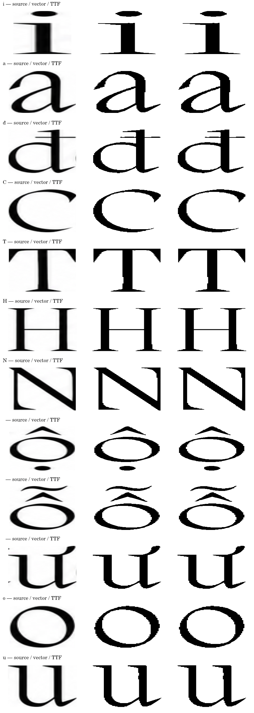

# Kiểm thử bộ tách trên ảnh nền trắng “Cỗ Tết Hà Nội xưa”

Ngày 19/11/2026. Nguồn là ảnh ChatGPT đã tạo trong hội thoại, 1234 × 1274 px; không phải font mẫu hệ thống. SHA-256: `544e80311b49111064467f30da1d869acba5b1c1b236696675acfb90e2136dd1`.

## Lỗi và thay đổi

- Trước sửa, ảnh chụp của người dùng cho thấy 2 glyph và dấu hiệu sai tên ký tự. Không có JSON vùng nhận diện của lượt đó để tái hiện chính xác; không quy toàn bộ lỗi đó cho một nguyên nhân duy nhất.
- Tìm được lỗi tái hiện bằng mã: `splitCleanWord` đo thân chữ theo chiều cao vùng crop. Khoảng trắng và dấu làm ngưỡng cao hơn thân chữ thường. Nay đo theo thành phần nét thực tế; không dùng dilation/erosion hoặc tăng stroke.
- Bổ sung định vị từ bằng khoảng trắng cột ảnh trong từng dòng đã phiên âm. Chỉ nhận ranh giới có khoảng hở rõ; không chia đều chiều rộng và không cắt nét dính để ép đủ số chữ. Vùng chưa chắc bị bỏ qua, có lý do lưu cùng ảnh.
- Nút Tạo bộ font nối lại Gemini dựng nền trắng khi ảnh có nền phức tạp. Ảnh đã sạch đi thẳng vào bộ tách. Ảnh gốc và ảnh Gemini là hai nguồn riêng liên kết trong cùng dự án; outline từ ảnh Gemini được ghi inferred/ai-redraw, không giả là nét gốc trực tiếp.
- Tên có ExtraLight/Light/... là lựa chọn kiểu của người dùng; không ép xác nhận lại chỉ vì AI đoán khác.

## Kiểm thử thực tế

Chạy `npm run check:clean`: dùng chính hàm traceDetectedWords của giao diện; Potrace WASM tạo outline; svg2ttf tạo file font; đọc/render TTF bằng @napi-rs/canvas, không dùng glyph font dự phòng.

**40 ký tự riêng có outline thật; 29 ký tự qua tất cả ngưỡng hình học mặc định, 11 chưa qua.** Không đánh dấu font hoàn thiện và không tự duyệt. Chữ i được lấy trực tiếp từ mẫu ở dòng Nội, có chấm trên, không suy luận từ ký tự khác. IoU TTF của i ≈ 0.99169, diện tích nét TTF/nguồn ≈ 0.99899. Điểm IoU không phải tỷ lệ giống thẩm mỹ tuyệt đối.

Đầu vào phiên âm và vùng dọc của bảy dòng được chú giải trong fixture kiểm thử; không chú giải crop từng glyph. Vì chưa gọi Gemini thật trong phiên này, kết quả 40/29 chỉ xác nhận bộ tách/vector/xuất TTF trên vùng dòng đúng; không cam kết trang web tự nhận ra đủ 40 ký tự ở mọi lượt gọi API.

| Chữ | IoU vector | IoU TTF | Diện tích nét TTF/nguồn | Qua ngưỡng |
|---|---:|---:|---:|---|
| C | 0.98124 | 0.98068 | 0.99981 | Có |
| ỗ | 0.97421 | 0.97355 | 0.99969 | Có |
| T | 0.99573 | 0.99597 | 0.99916 | Có |
| ế | 0.95790 | 0.95796 | 0.98273 | Chưa |
| t | 0.98991 | 0.98978 | 0.99932 | Có |
| H | 0.99873 | 0.99856 | 1.00003 | Có |
| à | 0.96544 | 0.96584 | 0.99564 | Chưa |
| N | 0.97697 | 0.97988 | 1.00007 | Có |
| ộ | 0.97530 | 0.97462 | 0.99836 | Có |
| i | 0.99118 | 0.99169 | 0.99899 | Có |
| đ | 0.98732 | 0.98677 | 0.99960 | Có |
| a | 0.97366 | 0.97326 | 1.00375 | Có |
| d | 0.98701 | 0.98692 | 0.99964 | Có |
| ạ | 0.97045 | 0.97045 | 1.00059 | Chưa |
| n | 0.98482 | 0.98486 | 0.99754 | Chưa |
| g | 0.97886 | 0.97862 | 0.99969 | Có |
| h | 0.99455 | 0.99434 | 1.00041 | Có |
| ư | 0.98523 | 0.98526 | 0.99748 | Chưa |
| ơ | 0.97876 | 0.97876 | 0.99960 | Có |
| v | 0.99412 | 0.99502 | 0.99989 | Có |
| ị | 0.98893 | 0.99026 | 0.99737 | Có |
| , | 0.98188 | 0.98053 | 1.00000 | Có |
| m | 0.98473 | 0.98505 | 0.99603 | Chưa |
| u | 0.99009 | 0.98965 | 0.99796 | Có |
| s | 0.97747 | 0.97661 | 1.00130 | Có |
| ắ | 0.97081 | 0.97040 | 0.99773 | Có |
| c | 0.97708 | 0.97641 | 1.00083 | Có |
| . | 0.97421 | 0.97227 | 0.99874 | Có |
| ù | 0.70805 | 0.70794 | 0.71647 | Chưa |
| y | 0.99294 | 0.99331 | 0.99847 | Chưa |
| ề | 0.97205 | 0.97148 | 0.99963 | Có |
| k | 0.97949 | 0.97941 | 0.99946 | Có |
| ệ | 0.97538 | 0.97516 | 0.99875 | Có |
| â | 0.96465 | 0.96450 | 0.99518 | Chưa |
| ũ | 0.98491 | 0.98425 | 0.99707 | Chưa |
| ợ | 0.98008 | 0.97996 | 1.00089 | Có |
| ự | 0.98148 | 0.98099 | 0.99408 | Chưa |
| e | 0.98072 | 0.98104 | 1.00005 | Có |
| o | 0.98180 | 0.98186 | 0.99985 | Có |
| á | 0.96999 | 0.96973 | 1.00026 | Có |

Chưa qua: ế, à, ạ, n, ư, m, ù, y, â, ũ, ự.

Từ chưa tách an toàn (có thể chứa nét chạm hoặc dấu khó gán): xưa, từng, gia, đình,, mức, nhau..

## Giới hạn

Ảnh AI đã có thể thay đổi nét so với ảnh xanh ban đầu. Phép đối chiếu này đo với ảnh sạch, không chứng minh sao chép chính xác font Migra gốc. Nét raster phóng lớn còn có bậc pixel; một số dấu/chi tiết chưa qua ngưỡng. Weight ExtraLight do tên người dùng chọn, không được xác minh bằng file font gốc. Chưa chạy lượt Gemini thực tế, kiểm browser, hay thử cài font trong ứng dụng.
