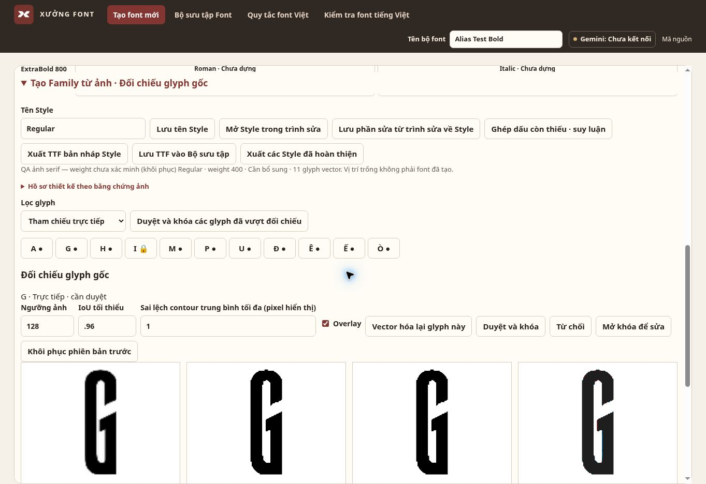

# Phạm vi triển khai và kiểm thử

Bản triển khai theo giai đoạn: đã có luồng dự án và phục dựng trực tiếp kiểm được; chưa nghiệm thu một family thành phẩm hoặc chữ i ExtraLight gốc.

## Đã triển khai

- 16 vị trí từ một tên Family; ảnh riêng từng Style, phân loại tự động có mức tin cậy, bắt xác nhận khi chỉ suy từ hình.
- Nhập nhiều PNG/JPG/WEBP, kéo thả, clipboard trong khu vực Family; xem lớn/xóa ảnh chưa dùng/thêm ảnh thay thế. 15 MB/ảnh, 40 triệu pixel, 80 MB ảnh và 100 ảnh/dự án.
- IndexedDB độc lập; tự lưu sau thao tác, backup/restore thành bản riêng, lịch sử 10 outline/glyph và 100 sự kiện dự án. Không đổi schema hay xóa dữ liệu font/ảnh cũ.
- Nhánh Family truy vết ở độ phân giải gốc của ảnh; chỉ ảnh gửi AI nhận diện mới được thu nhỏ. Luồng ảnh đơn cũ vẫn giữ giới hạn preview để tương thích tọa độ đã lưu.
- Nguồn trực tiếp và suy luận riêng; chỉ ghép dấu khi có contour mẫu. Không vẽ lại ảnh nguồn bằng Gemini, không tự fit thân m/n/u hay thay A, không chỉnh x-height riêng từng phần trên nhánh trực tiếp.
- Đối chiếu ảnh cắt/vector/glyph browser render từ TTF, overlay, IoU/contour/tỷ lệ/diện tích/số lòng kín. Một scale chung lấy từ ảnh. Không font dự phòng trong đối chiếu.
- Ngưỡng tùy chọn, vector hóa lại một glyph, từ chối/duyệt/khóa, quay lại outline trước; glyph khóa được bảo vệ trong trình sửa và khi phục dựng lại.
- Xuất TTF nháp thật; lưu file sang Bộ sưu tập; mở/sửa/lưu ngược về Style. Không đánh dấu hoàn thiện chỉ vì xuất được file.
- Chặn nhánh offset/shear cho Family từ ảnh; bảo vệ các slot gốc, kiểm thiếu/rỗng glyph và weight trước nhánh family cũ, loại bản sinh làm mất lòng hoặc nối/tách contour.
- AI đối chiếu đề xuất sửa dấu rời theo quy tắc; kiểm TTF nháp trước áp dụng và kiểm lại sau áp dụng/hoàn tác.

## Bằng chứng nguyên nhân

- `wordInk` trước đây có hai lượt mở rộng từ pixel nét sang pixel xám lân cận.
- `cropToImageData` có nhánh làm mượt coverage; Potrace có dung sai cao hơn và tối ưu curve.
- `makeGlyph` có nhánh fit riêng m/u và refine outline.
- `alignReferenceGlyphs` có biến đổi x-height theo từng phần và gọi unifyReferenceA.
- Luồng tạo bộ font bật mặc định vẽ lại ảnh để làm sạch/vẽ chữ còn thiếu; luồng xuất có sửa t/q/u.
- Đầu vào cũ gom nhiều ảnh vào một bộ glyph chung, không quản lý độc lập theo Style. Phân loại sai vẫn là rủi ro nếu chưa xác nhận ảnh.

Những điểm trên là hành vi có thật trong mã, không phải kết luận Gemini đã phân tích sai một yêu cầu cụ thể. Chưa có dữ liệu trung gian i gốc để quy một nguyên nhân duy nhất cho hình i người dùng đã thấy.

## Đã kiểm

- `npm run build`: qua.
- `npm run check:quality`: 146 mã, glyph thiếu/rỗng, NFD chưa xác minh, WOFF, khoảng dấu và giao outline: qua.
- `npm run check:family`: bảo vệ slot, glyph thiếu/rỗng, weight mismatch, chặn offset cho dự án ảnh, mất lòng chữ, cmap đầu ra và nhập font; kiểm schema AI và route Gemini bằng mock, không gọi dịch vụ trả phí: qua.
- `npm run check:reconstruction`: kiểm mẫu i tổng hợp có thân mảnh/chân mảnh, contour/TTF, metadata 200, glyph khóa, dự án thiếu dữ liệu: qua. Không phải mẫu i gốc.
- 11 glyph trên ảnh thật do người dùng cung cấp: có vector, cmap và render TTF thật; IoU TTF 0.9797–0.9969. Xem báo cáo đối chiếu riêng. Vùng crop được chú giải thủ công cho kiểm thử; không tuyên bố AI tự phân loại ảnh đó.
- Chrome qua Cloud Browser: tạo Family rỗng, 16 vị trí, restore backup có ảnh+11 vector, đối chiếu glyph I qua FontFace thật, overlay, duyệt/khóa và tải lại còn khóa, nhập hai ảnh một lần và lưu qua tải lại, xuất TTF nháp và báo thiếu ký tự, thông báo thiếu API key giữ nguyên dữ liệu; lưu TTF sang Bộ sưu tập thành công.
- Bộ sưu tập và tab quy tắc/kiểm tra font được kiểm riêng trong trình duyệt. Không sửa mã ColorME.

## Chưa nghiệm thu

- Chữ i thường đúng font ExtraLight Roman của người dùng: chưa có ảnh gốc đủ rõ trong hai attachment hiện tại. Không thay bằng I hoa hoặc i tổng hợp để báo đạt.
- Gọi Gemini thật và độ chính xác phân loại trên bộ ảnh Roman/Italic/nhiều weight: chưa có API key khả dụng trong phiên kiểm thử. Hợp đồng API đã kiểm bằng mock.
- Sinh mới các chữ thiếu không có contour/thành phần tham chiếu: giữ thiếu, chưa triển khai suy luận cấu trúc tổng quát.
- Tự chứng nhận serif, stress angle, baseline quang học, vị trí dấu và shaping NFD; hồ sơ AI là mô tả bằng chứng, metrics ảnh là tương đối chưa xác minh.
- Phục hồi chắc chắn nét bị watermark che, ảnh quá mờ hoặc chữ dính: không tự bịa contour; cần ảnh tốt hơn hoặc can thiệp vùng cắt.
- Firefox/Edge, cài font trong ứng dụng Windows và full family đủ bộ chữ: chưa kiểm trên môi trường đó.
- Báo cáo không xác nhận chuẩn thương mại hoặc khả năng bán font.

## Tệp chính

- `site/family-project.js`, `site/family-workspace.js`: dữ liệu, IndexedDB, backup, 16 Style, glyph manager và nối trình sửa.
- `site/reference-image.js`, `site/reference-placement.js`, `site/engine.js`, `site/font-layout.js`: threshold và trace trực tiếp, đặt metrics bằng một scale, bảo vệ outline.
- `site/reconstruction-proof.js`, `site/reconstruction-metrics.js`: so ảnh/vector/TTF và các số đo.
- `api/glyph-review.mjs`, `src/family-analysis.mjs`, `src/repair-plan.mjs`, `site/ai-mark-repair.js`: phân loại ảnh và đối chiếu sửa dấu có giới hạn.
- `site/font-family.js`, `site/family-validation.js`, `site/font-collection.js`, `site/font-import.js`, `site/vietnamese.js`: bảo vệ family, cmap, nguồn glyph và tái sử dụng dấu có mẫu.
- `site/app.js`, `site/index.html`, `site/style.css`, `site/font-check-panel.js`: tích hợp giao diện hiện có, khóa glyph và kiểm lại sau sửa.
- `scripts/check-family.cjs`, `scripts/check-reconstruction.cjs`, `reports/`, `README.md`, `package.json`: kiểm thử và tài liệu.

Ảnh kiểm thử Chrome trước lượt nạp lại cuối:

Lượt nạp lại bản xem thử cuối bị chính sách URL của Cloud Browser chặn; không thử vòng qua. Các thao tác được liệt kê ở trên đã quan sát thành công trước thời điểm đó. Kiểm thử Node/build cuối vẫn qua. Vercel connector hiện trả danh sách dự án rỗng trong team IMAGE STUDIO; tình trạng triển khai sẽ được đối chiếu thêm qua GitHub status sau commit.
