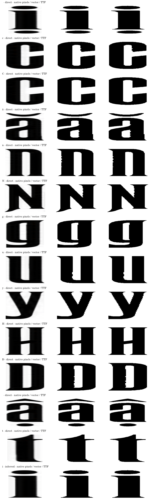

# Đối chiếu bổ sung: chữ thường và glyph i

Nguồn: ảnh “Ba tên Việt trên nền trắng(4).png” do người dùng cung cấp. Weight/Style không có nhãn để xác minh; 400 chỉ là metadata kiểm serialization, không phải kết luận đây là Regular hay ExtraLight.

13 glyph được crop theo chú giải để kiểm contour trực tiếp. Chữ nhìn thấy là ị, không phải i. i được tạo bằng cách bỏ duy nhất contour dấu nặng rời của ị; giữ nguyên thân, chấm trên, advance và phép đặt. i luôn được đánh dấu inferred, không gọi là mẫu trực tiếp.

| Glyph | Nguồn | Cutoff gốc | IoU vector | IoU TTF | Diện tích TTF/nguồn | Lệch contour lớn nhất | Qua ngưỡng |
|---|---|---:|---:|---:|---:|---:|---|
| ị | direct | 129 | 0.9966 | 0.9949 | 0.9999 | 2.000 | Có |
| c | direct | 129 | 0.9973 | 0.9967 | 0.9999 | 2.414 | Có |
| C | direct | 125 | 0.9973 | 0.9924 | 1.0049 | 2.414 | Có |
| ă | direct | 129 | 0.9953 | 0.9934 | 1.0016 | 2.000 | Có |
| n | direct | 131 | 0.9984 | 0.9975 | 0.9998 | 2.414 | Có |
| N | direct | 130 | 0.9984 | 0.9965 | 1.0007 | 2.414 | Có |
| g | direct | 130 | 0.9981 | 0.9956 | 1.0007 | 2.414 | Có |
| u | direct | 129 | 0.9992 | 0.9991 | 0.9999 | 1.414 | Có |
| y | direct | 130 | 0.9986 | 0.9958 | 1.0027 | 1.414 | Có |
| H | direct | 130 | 0.9990 | 0.9909 | 1.0041 | 2.000 | Có |
| Đ | direct | 128 | 0.9988 | 0.9982 | 0.9998 | 2.828 | Có |
| ạ | direct | 129 | 0.9935 | 0.9916 | 0.9996 | 2.828 | Có |
| t | direct | 131 | 0.9968 | 0.9965 | 1.0000 | 1.414 | Có |
| i | inferred | 129 | 0.9977 | 0.9961 | 0.9998 | 2.000 | Có |

Đo bằng hàm reconstructionProof dùng trong sản phẩm, với rasterizer font thực của @napi-rs/canvas trong harness Node (FontFace adapter). Không sử dụng font hệ thống thay thế. Chưa chạy lại giao diện/browser ở giai đoạn này. Crop được chú giải cho kiểm thử, không tuyên bố Gemini tự nhận diện đúng chúng.

Ngưỡng rà soát: IoU ≥0.96, contour trung bình ≤1 px soát, lệch cục bộ ≤4 px soát, tỷ lệ ≤2%, số lòng kín không đổi. Không chứng nhận serif, baseline quang học hay độ giống tuyệt đối. Chưa nghiệm thu đúng Style ExtraLight Roman vì nguồn không xác minh Weight.

## Các lỗi được sửa trong lượt này

- Threshold Otsu 0 là hợp lệ. Trước đây nhánh đối chiếu dùng `gray < 0`, khiến mask nguồn rỗng dù nhánh trích xuất `gray <= 0` có nét. Nay cả hai dùng cùng luminance và điều kiện cutoff.
- Trước đây threshold được áp sau khi resize ảnh để soát, có thể làm mất nét mảnh hoặc lệch mép do nội suy. Nay threshold pixel gốc trước, rồi ánh xạ mask bằng cùng phép scale.
- Vector hóa lại trước đây ép polarity dark. Nay giữ polarity nguồn và kiểm round-trip cutoff ở cả chữ tối/chữ sáng.
- Bộ khoảng cách contour thiếu hai hướng chéo. Nay kiểm đối xứng đủ hướng; thêm giới hạn lệch chi tiết cục bộ để bắt mất serif nhỏ dù IoU tổng còn cao.
- Từ chối cấu hình ngưỡng NaN/vô hạn, kích thước không hợp lệ. Proof có phiên bản; kết quả cũ giữ nguyên nhưng không dùng để cấp duyệt mới. Ngưỡng proof phải khớp ngưỡng phục dựng.
- Thêm đối chiếu toàn Style, giữ glyph khóa. Khi có nhiều nguồn cho cùng glyph, không thay nguồn trực tiếp độ phân giải cao hơn bằng ảnh nhỏ hơn chỉ do thứ tự xử lý.

Kiểm hồi quy: build, check:family, check:quality và check:fidelity qua. Hàm production reconstructionProof đã chạy với ảnh thật và TTF thật trong harness; kiểm ngưỡng 0 và polarity ở cả hai hướng, mất serif cục bộ, ngưỡng sai, proof cũ, version glyph thay đổi. Không có migration IndexedDB; không xóa hoặc thay dữ liệu đã lưu.

Các tệp sửa: `site/reference-mask.js`, `site/reference-image.js`, `site/reconstruction-proof.js`, `site/reconstruction-metrics.js`, `site/reference-components.js`, `site/proof-approval.js`, `site/family-workspace.js`, `scripts/check-reference-fidelity.cjs`, `package.json`; báo cáo và ảnh so sánh đi kèm.

Vẫn chưa nghiệm thu: Style ExtraLight Roman của ảnh chưa xác minh, phân loại Gemini thật, thiết kế serif/baseline quang học, phục hồi nét bị che bởi watermark và tái kiểm giao diện Firefox/Edge. Không có dữ liệu font lỗi i cũ để định lượng trước/sau trên chính file lỗi đó.
