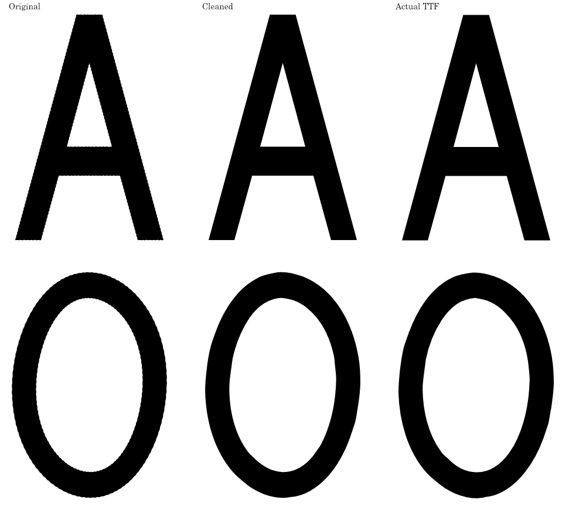

# Nắn thẳng và làm mượt outline — 20/11/2026

Thêm nút ngay trong cửa sổ xem ký tự, dùng được với glyph nhập từ TTF hoặc glyph mượn từ Style khác mà không cần ảnh nguồn hoặc gọi AI. Có xem trước, chồng hình, Áp dụng, Trở lại và một mức Hoàn tác được lưu cùng glyph.

## Thuật toán

- Đọc contour SVG tuyệt đối, chuyển Q/arc thành đường lấy mẫu để đo, giữ mọi contour độc lập và hướng đi.
- Tìm góc theo hướng biên trong một cửa sổ độ dài cung; giữ các góc rõ. Với vòng cong không có góc, dùng các cực trị làm điểm chia; không suy ra ellipse hay áp đối xứng.
- Khớp các chuỗi gần thẳng bằng đoạn L; khớp phần cong bằng Bézier cubic bình phương tối thiểu, chia đệ quy khi vượt sai số. Tiếp tuyến tại điểm chia cong được dùng chung.
- Giới hạn khoảng lệch hai chiều, biến đổi diện tích mỗi contour ≤5%, diện tích nét có dấu tổng ≤2%; từ chối đổi chiều contour, giao nhau mới hoặc outline chưa khép kín. Các ngưỡng Nhẹ/Vừa/Rõ là 0.75/1.5/3 đơn vị font, có dung sai lấy mẫu 0.2 đơn vị, không phải tiêu chuẩn thẩm mỹ.
- Không đổi advance, baseline hay metadata Weight/Style. Không áp dụng stroke offset, morphology, raster hóa để tạo outline mới, hoặc đổi O thành hình tròn/oval chuẩn.

## Kiểm thử

`npm run check:outline` kiểm hình học và UI bằng DOM adapter. Dữ liệu A/O dưới đây là mẫu kiểm thử có nhiễu biết trước, không phải hai glyph trong ảnh chụp của người dùng (chưa có file outline của chúng).

| Mẫu | Lệnh vẽ trước → sau | Lệch biên lớn nhất | Đổi diện tích nét |
|---|---:|---:|---:|
| A có cạnh nhiễu | 998 → 15 | 0.600 đơn vị | −0.0092% |
| O có vòng cong nhiễu, bất đối xứng nhẹ | 802 → 37 | 1.237 đơn vị | +0.1740% |

Kiểm góc A, lòng chữ, chiều contour, giới hạn diện tích; không sửa đối tượng gốc khi xem trước. Xuất file TTF thật và đọc lại cmap/advance, render qua font rasterizer @napi-rs/canvas đã đăng ký đúng font thử; IoU vector mới/TTF >0.97 cho A và O, không dùng glyph dự phòng.

DOM adapter kiểm: Xem trước/Trở lại chưa ghi dữ liệu; Áp dụng vô hiệu hóa kết quả đối chiếu và duyệt cũ; JSON lưu/tải lại giữ outline hoàn tác; khóa, bản xem trước cũ và lỗi lưu không ghi đè glyph.

Build, check:family và check:quality đã qua. Không có thay đổi schema IndexedDB hoặc xóa font trong Bộ sưu tập. Bản đang làm được lưu vào localStorage; Family có sourceProjectId được lưu đúng dự án/Style qua cơ chế hiện có.

## Giới hạn

Không chứng nhận giữ tuyệt đối mọi chi tiết hay chữa mọi outline. Chỗ quá sát, ký tự nhỏ hoặc biên phức tạp có thể bị từ chối; cần chọn Nhẹ hoặc giữ nguyên. Nét trên ảnh chụp chưa có file SVG/TTF để kiểm lại chính hai chữ đó.

Không thực hiện kiểm thử giao diện bằng trình duyệt trong môi trường này: Chromium không khởi chạy vì socket bị từ chối. DOM adapter không thay thế kiểm bố cục và tương tác trình duyệt thực. Không gọi Gemini hay thay đổi kết nối API ở bản này.

## Cập nhật: nắn thẳng và dựng lại góc nhọn

Bản đầu chỉ cho dịch nét 0.75–3 đơn vị nên không xóa được gồ ghề do dò ảnh và không sửa được góc đã bị bo. Bản này:

- Tìm các đoạn gần thẳng (lệch ≤ 2.5×mức+2 đơn vị, không võng có hệ thống) và thay bằng một đường thẳng khớp phần giữa đoạn.
- Hai cạnh thẳng gặp nhau qua một đoạn bo ngắn (≤ 2.5×(10×mức+10)) được nối tại giao điểm: góc nhọn như chữ in, kể cả đỉnh hẹp của A.
- Đoạn thẳng ngắn không chạm góc được coi là một phần đường cong; phần cong làm mịn rồi khớp Bézier, nối liền tiếp tuyến với cạnh thẳng kề.
- Giữ kiểm tra chiều contour, tự cắt, giao nhau, đổi diện tích (≤8% mỗi contour, ≤4% tổng). Lệch lớn nhất cho phép tăng theo bán kính góc được làm nhọn.

`npm run check:outline` thêm mẫu A có góc bo bán kính 16 và gồ ghề ±3 đơn vị: ở cả ba mức đều ra 11 cạnh thẳng, 11 góc nhọn đúng vị trí gốc; O giữ hoàn toàn là đường cong.
- Outline sạch (cạnh thẳng tuyệt đối, như font vẽ sẵn hoặc glyph mượn đã sửa nối góc miter) giữ nguyên góc bo cố ý và mọi đỉnh gốc; chỉ nét còn răng cưa do dò ảnh mới được dựng lại góc nhọn. Góc gốc khóa theo `hardCorners` chỉ áp dụng khi outline không có răng cưa. `check:corners` và `check:outline` cùng qua.
