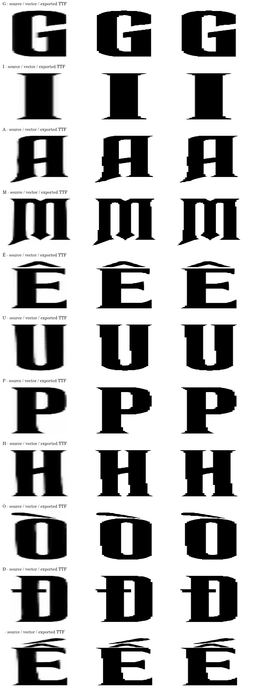

# Kiểm thử phục dựng từ ảnh thật

Nguồn: ảnh chụp giao diện người dùng gửi (1903 × 1008), vùng chữ GIA MIÊU PHÒ ĐẾ. Các vùng glyph được chú giải thủ công cho kiểm thử; không phải kết quả phân loại Gemini. Weight và Style gốc chưa được xác minh. Không có chữ i thường ExtraLight để nghiệm thu.

Pipeline: threshold 128 → Potrace WASM, alphamax 0.35, opticurve 0 → một scale đồng nhất → svg2ttf → đọc cmap → render bằng rasterizer font thực. Không dilation/erosion, không AI vẽ lại.

| Glyph | IoU vector trước | IoU vector sau | IoU TTF | Diện tích TTF/nguồn | Contour TB (px ở 4×) | Qua ngưỡng rà soát |
|---|---:|---:|---:|---:|---:|---|
| G | 0.8036 | 0.9846 | 0.9851 | 1.0048 | 0.276 | Có |
| I | 0.4288 | 0.9967 | 0.9969 | 0.9988 | 0.056 | Có |
| A | 0.2307 | 0.9844 | 0.9845 | 0.9943 | 0.291 | Có |
| M | 0.1995 | 0.9797 | 0.9797 | 0.9921 | 0.362 | Có |
| Ê | 0.5157 | 0.9918 | 0.9915 | 0.9990 | 0.143 | Có |
| U | 0.9057 | 0.9817 | 0.9820 | 1.0021 | 0.319 | Có |
| P | 0.4875 | 0.9894 | 0.9896 | 1.0017 | 0.201 | Có |
| H | 0.8856 | 0.9854 | 0.9852 | 0.9983 | 0.270 | Có |
| Ò | 0.5717 | 0.9884 | 0.9887 | 1.0023 | 0.208 | Có |
| Đ | 0.3025 | 0.9879 | 0.9881 | 1.0072 | 0.229 | Có |
| Ế | 0.4249 | 0.9809 | 0.9804 | 1.0061 | 0.317 | Có |

Cột trước dùng nhánh cũ tại commit 04ab824, gồm cả sai khác do đặt metrics/scale; không fit lại riêng từng outline để che sai vị trí hoặc tỷ lệ. Cột trước là vector, không phải phép đo font cũ trên máy của người dùng.

Ngưỡng do Xưởng chọn: IoU ≥ 0.96, contour TB ≤ 1 pixel ở 4×, sai tỷ lệ ≤ 2%, số lòng kín không đổi. Không phải chứng nhận thẩm mỹ hay giống 100%.

Kiểm i: fixture tổng hợp với thân 4 pixel và chân 2 pixel, weight metadata 200; IoU vector 0.9976, IoU TTF 0.9792. Fixture này chỉ kiểm hồi quy giữ nét mảnh, không đại diện cho i gốc của người dùng.

Các mục chưa đạt ngưỡng vẫn là needs-review. Serif, vị trí dấu và baseline quang học chưa được xác nhận tự động. Không nghiệm thu ExtraLight Roman từ ảnh này.
