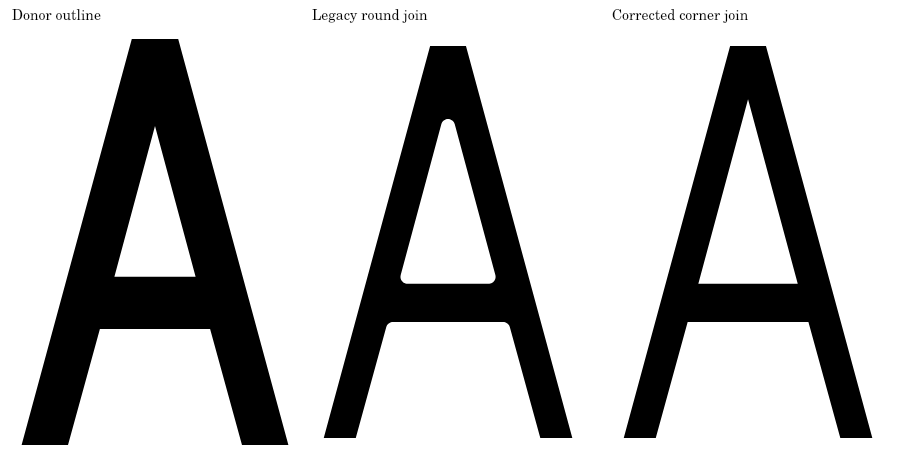
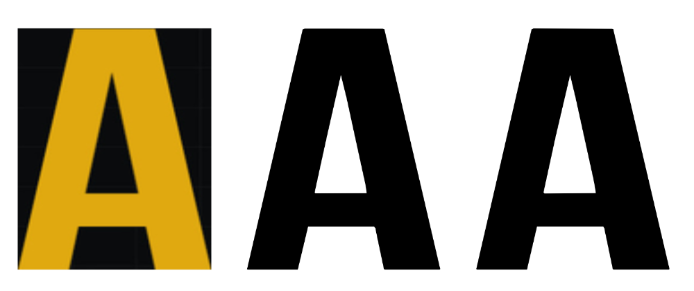

# Giữ góc sắc của mẫu — 20/11/2026

## Nguyên nhân kiểm chứng bằng mã

`site/borrow-glyphs.js` dùng Clipper `jtRound` khi đổi độ đậm glyph mượn từ SemiBold. Offset âm mở rộng lòng chữ và tạo góc tròn ngay ở đỉnh tam giác, góc chân trong. Có thể tái hiện kiểu A bo tương tự ảnh người dùng trước khi chạy công cụ nắn; vì vậy chưa đủ cơ sở quy mọi góc bo cho nút làm mượt.

Ngoài ra, bước truy vết ảnh có chế độ `alphamax:1`, `turdsize:2`. Bản sửa chuyển về ngưỡng góc bảo thủ `.35`, không loại thành phần nhỏ (`turdsize:0`). Đây là điều chỉnh tham số có kiểm thử, không phải chứng nhận mọi glyph đều chính xác.

## Thay đổi

- Đổi round join thành miter join, miter limit 16. Không thay đổi chênh lệch độ đậm đã chọn. Glyph mượn mới lưu `borrowedOriginal` và `borrowedJoin`.
- Nhận diện thêm gián đoạn tiếp tuyến ở các đoạn gốc; khóa đúng tọa độ các góc rõ trước khi khớp Bézier, kể cả góc trong. Giữ đường cong có tiếp tuyến liên tục của glyph vốn có thiết kế bo tròn.
- Trong bản xem trước Nắn thẳng, glyph mượn cũ có thể dựng lại từ đúng donor còn trong Family với miter join. Không tìm thấy donor thì không bịa hình mới; thông báo chỉ giữ góc hiện có.
- Chỉ Áp dụng mới ghi bản sửa, giữ outline cũ để hoàn tác. Bản xem trước cũ/lỗi async không ghi đè glyph đã thay đổi. Glyph khóa không được sửa.

## Kiểm thử

`npm run check:corners`:

1. Tái hiện A có góc trong bo bằng round-offset âm. Dùng cùng source và amount để sửa bằng miter. Cả ba mức Nhẹ/Vừa/Rõ giữ nguyên tọa độ mọi đỉnh polygon của outline sửa; không có lệnh C tự thêm vào A polygon. Số contour/lòng chữ và advance giữ nguyên. Có kiểm khóa, không có donor, và glyph bo tròn chủ ý vẫn còn đường cong.
2. Dùng chính ảnh 600×239 “BEBAS” người dùng gửi. Vùng A được chú giải x=365..481, y=20..228; không tuyên bố tự nhận diện vùng. Truy vết, nắn và xuất TTF thật, render bằng font rasterizer @napi-rs/canvas đã đăng ký font vừa xuất. IoU với mask nguồn khoảng 0.98435, một lòng kín, không có cảnh báo ở ngưỡng kiểm hình học mặc định. Điểm này không phải chứng nhận giống mẫu tuyệt đối.

Build, check:outline (hình học/TTF và DOM adapter), check:family, check:quality đều được chạy. Không thay phiên bản IndexedDB hoặc xóa dự án/font.

## Giới hạn

Không đọc được trạng thái glyph đang lưu riêng trong trình duyệt của người dùng. Chỉ phục hồi tự động nếu còn source donor đáng tin cậy; góc đã bo trong chính donor không thể suy ra hoàn toàn từ một ảnh chụp. Không kiểm giao diện trình duyệt thực ở lượt này. Các đường cong/nét cực nhỏ vẫn cần xem trước và duyệt; miter rất nhọn có thể bị giới hạn bởi miter limit.
